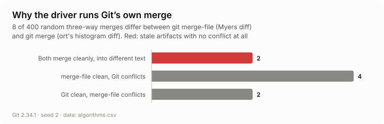
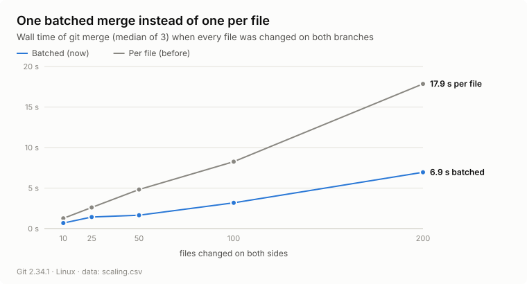

# Merge driver evaluation — 2026-10-15

**Status: exploratory.** These measurements were not preregistered. They
describe the behaviour of the `.semantic/` merge driver on this repository and
on synthetic histories; they are not a comparative claim about other tools.

| | |
| --- | --- |
| AIGit commit | `25dae73` |
| Git | 2.34.1 (the test suite also passes on 2.47.1 and 2.55.0) |
| Python | 3.10.12 |
| Platform | Linux (WSL2), x86-64 |
| Raw data | [`data/`](data/) — one row per trial, plus a JSON summary with the environment |
| Figures | [`figures/`](figures/) — rendered from `data/` by `experiments/merge_driver/plots.py` |

<picture>
  <source media="(prefers-color-scheme: dark)" srcset="figures/headline-dark.svg">
  
</picture>

## The question

`.semantic/` is derived from the source. After any merge, the only correct
artifacts are the ones `aigit chunk` would write for the merged source. So
every merge here is judged by one test: **are the committed artifacts byte for
byte what a rebuild produces?** Each merge ends in exactly one outcome:

| Outcome | Meaning |
| --- | --- |
| merged, fresh | clean merge; artifacts equal a rebuild |
| stopped: source | a source file genuinely conflicts — a human must decide anyway |
| stopped: nothing to apply | Git stops a cherry-pick that became empty |
| stopped needlessly | only `.semantic/` conflicted; the source merged cleanly |
| merged, **stale** | clean merge; artifacts silently describe the wrong source |

A stale result is the one failure that is never acceptable: nothing tells
anyone it happened.

## 1. Replayed concurrent changes

[`replay.py`](../../../../experiments/merge_driver/replay.py) — 150 trials,
seed 4. Each trial branches twice from a snapshot of this repository. Each side
makes one random change (insert or edit a line, add, delete or rename a file),
to the same file half of the time. The pair is then combined by `git merge`,
`git rebase` and `git cherry-pick`, once with Git's line-based text merge for
the artifacts and once with the AIGit driver.

<picture>
  <source media="(prefers-color-scheme: dark)" srcset="figures/replay-outcomes-dark.svg">
  
</picture>

| Operation | Method | Fresh | Source conflict | Nothing to apply | Needless stop | Stale |
| --- | --- | ---: | ---: | ---: | ---: | ---: |
| `git merge` | text merge | 85 | 25 | 0 | 40 | 0 |
| `git merge` | AIGit driver | **125** | 25 | 0 | **0** | 0 |
| `git rebase` | text merge | 85 | 25 | 0 | 40 | 0 |
| `git rebase` | AIGit driver | **125** | 25 | 0 | **0** | 0 |
| `git cherry-pick` | text merge | 82 | 25 | 3 | 40 | 0 |
| `git cherry-pick` | AIGit driver | **122** | 25 | 3 | **0** | 0 |

Every needless stop became a fresh merge; genuine source conflicts are
untouched. Of the text merge's 40 needless stops, 35 came from the 75 trials
that edited the same file and 5 from the 75 that edited *different* files —
neighbouring manifest lines are enough to collide.

The text merge shows no stale results here only because every chunk now
carries its file's hash, which forces any same-file disagreement into a
visible conflict. Before that change, an earlier version of this replay
measured 2 silently stale text merges in 300 same-file trials: two edits that
each shifted a chunk by one line both recorded "+1", and Git kept one.

## 2. `git merge-file` versus `git merge`

[`algorithms.py`](../../../../experiments/merge_driver/algorithms.py) — 400
trials, seed 2. When both sides change a file, the driver must reproduce
Git's merge of it. An early version used `git merge-file`, which diffs with
Myers; the ort strategy behind merge, rebase and cherry-pick
[uses histogram](https://github.com/git/git/commit/bac0e96967b437a210815ce6f6357db41c5eff3d).
Random three-way merges of small, repetitive files show how often that matters.

<picture>
  <source media="(prefers-color-scheme: dark)" srcset="figures/algorithm-divergence-dark.svg">
  
</picture>

| Verdict | Merges |
| --- | ---: |
| agree | 392 |
| both clean, different text | **2** |
| `merge-file` clean, `git merge` conflicts | 4 |
| `git merge` clean, `merge-file` conflicts | 2 |

The two "both clean" cases would have produced stale artifacts with no
conflict. The driver therefore runs ort itself, in a throwaway repository,
under the user's configuration. One of these cases is a regression test.

## 3. Corner-case sweep

[`sweep.py`](../../../../experiments/merge_driver/sweep.py) — 32 scenarios,
each a small history and one Git operation. A correct tool merges fresh, stops
on a genuine source conflict, or — where Git cannot be followed or the inputs
are already wrong — declines with a conflict that asks for `aigit chunk`.
**All 32 behaved as expected; none was stale.**

| Command | Scenario | Outcome | Seconds |
| --- | --- | --- | ---: |
| `git merge` | Same file edited on both sides | fresh | 1.17 |
| `git merge --squash` | Squash merge | fresh | 1.21 |
| `git merge b1 b2` | Three heads in one merge (octopus) | declined¹ | 0.34 |
| `git merge` | Two merge bases (criss-cross history) | fresh | 2.22 |
| `git merge` | Both branches adopted AIGit separately | fresh | 1.29 |
| `git merge` | Other branch's artifacts already stale | declined² | 0.98 |
| `git merge` | This branch's artifacts already stale | declined² | 1.11 |
| `git merge` | Symlink to a file both sides edit | fresh | 1.38 |
| `git merge` | Source file that is not UTF-8 | fresh | 1.34 |
| `git merge` | Edit vs rename of a path with spaces and accents | fresh | 1.42 |
| `git merge` | Edit vs rename to a type outside the layer (.png) | fresh | 0.89 |
| `git merge` | Both sides rename one file differently | source conflict | 1.03 |
| `git merge` | `.semantic/` deleted on one side | declined³ | 0.11 |
| `git merge` | Merge result no longer parses | fresh | 1.30 |
| `git merge` | Empty file filled on one side | fresh | 1.04 |
| `git merge` | 100 files edited on both sides | fresh | 10.97 |
| `git merge` | Merge run from a subdirectory | fresh | 1.30 |
| `git merge` | Merge inside a linked worktree | fresh | 0.99 |
| `git -c merge.renormalize=true merge` | Option that changes how Git merges files | declined⁴ | 0.96 |
| `git rebase` | Rebase a branch | fresh | 1.15 |
| `git rebase -i` | Reorder commits interactively | fresh | 2.30 |
| `git rebase --rebase-merges` | Rebase that replays a merge | fresh | 4.17 |
| `git rebase --onto` | Transplant a branch | fresh | 1.33 |
| `git rebase --autostash` | Rebase over uncommitted work | fresh | 1.35 |
| `git pull --rebase` | Pull with rebase from a remote | fresh | 1.36 |
| `git cherry-pick` | Cherry-pick one commit | fresh | 1.34 |
| `git cherry-pick A..B` | Cherry-pick a range | fresh | 2.47 |
| `git cherry-pick` | File stored with CRLF line endings | fresh | 1.27 |
| `git revert` | Revert a commit older than HEAD | fresh | 1.15 |
| `git stash pop` | Pop work stashed before a newer commit | fresh | 5.30 |
| `git am -3` | Apply an emailed patch | fresh | 1.30 |
| `git checkout -m` | Switch branches carrying uncommitted work | declined⁵ | 1.08 |

¹ Git runs no merge driver for octopus merges. ² A merge cannot repair inputs
that are already wrong; declining keeps the staleness visible. ³ A
modify/delete, which Git never hands to a driver. ⁴ The driver will not predict
a file merge Git performs differently. ⁵ Uncommitted work has no commit to
verify against.

The merge-queue form, `git merge-tree --write-tree A B`, needs Git 2.38+ and is
covered by the test suite (`test_merge_tree_as_merge_queues_run_it`), which runs
on CI's Git rather than the 2.34 used here.

## 4. Cost

[`scaling.py`](../../../../experiments/merge_driver/scaling.py) — every file
changed on both sides, median of 3 runs. "Per file" is the earlier variant,
which ran one throwaway ort merge per contested file.

<picture>
  <source media="(prefers-color-scheme: dark)" srcset="figures/scaling-dark.svg">
  
</picture>

| Files changed on both sides | Per file (s) | Batched (s) | Speed-up |
| ---: | ---: | ---: | ---: |
| 10 | 1.27 | 0.68 | 1.9× |
| 25 | 2.60 | 1.43 | 1.8× |
| 50 | 4.82 | 1.65 | 2.9× |
| 100 | 8.26 | 3.18 | 2.6× |
| 200 | 17.86 | 6.95 | 2.6× |

Batching removes the per-file repository setup, but cost still grows linearly
— about 35 ms per contested file, mostly spent re-chunking each side's source
to verify it against that side's artifact. Files changed on only one side cost
nothing extra. A merge touching hundreds of files on both sides is the case to
watch.

## Threats to validity

- **One corpus.** The replay uses this repository (Python and Markdown); other
  languages exercise other parsers.
- **Synthetic edits.** One random line-level change per side. Real changes are
  larger and correlated, which makes same-file collisions likelier.
- **Synthetic divergence corpus.** Experiment 2 uses small repetitive files,
  chosen to make the two diff algorithms disagree; it measures possibility,
  not frequency in real code.
- **One machine.** Timings are from one WSL2 machine and are only comparable
  within this run.
- **Not covered:** Windows (the process lookup that detects merge options is
  untested there) and hosted merge buttons (covered by the live GitHub test
  recorded in the changelog, not by this harness).

## Reproduce

```bash
OUT=docs/evals/results/2026-10-15-merge-driver
python experiments/merge_driver/replay.py --trials 150 --seed 4 --out $OUT/data
python experiments/merge_driver/algorithms.py --trials 400 --seed 2 --out $OUT/data
python experiments/merge_driver/sweep.py --out $OUT/data
python experiments/merge_driver/scaling.py --sizes 10,25,50,100,200 --repeats 3 --out $OUT/data
python experiments/merge_driver/plots.py --data $OUT/data --out $OUT/figures
```

or `make merge-driver-eval`. Expect about ten minutes. Outcome counts are
deterministic for a given seed, AIGit commit and Git version; timings are not.
